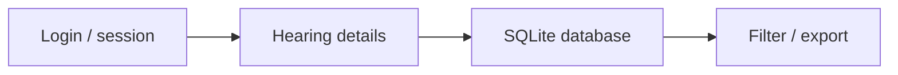

<div align="center"></div>

# Court Agenda | أجندة المحامي

**Streamlit · Python · SQLite · Arabic RTL**

A lightweight local court-agenda experiment for recording hearings and associated matter details through a browser-based Streamlit interface.

## Verified structure

- `app.py` — Streamlit application and local SQLite access.
- `requirements.txt` — Streamlit, pandas and bcrypt.
- `.devcontainer/` — optional development-container settings.



## Run

```bash
python -m pip install -r requirements.txt
streamlit run app.py
```

Start in a local environment; configure safe storage and access before exposing the service to any network. The application is a historical Streamlit prototype, distinct from [the current Flutter Judicial Agenda](https://github.com/matef-hub/agenda).

### Notes

- **bcrypt** is included; verify session and authorization behavior before using real client data.
- Backup and calendar integrations mentioned in older documentation should be individually verified; do not rely on them without an end-to-end restore test.
- Avoid uploading private hearings, customer names or court documents into public issues.

**Developed by [Mohamed Atef](https://github.com/matef-hub)** — Egyptian lawyer & Legal Tech Developer.
